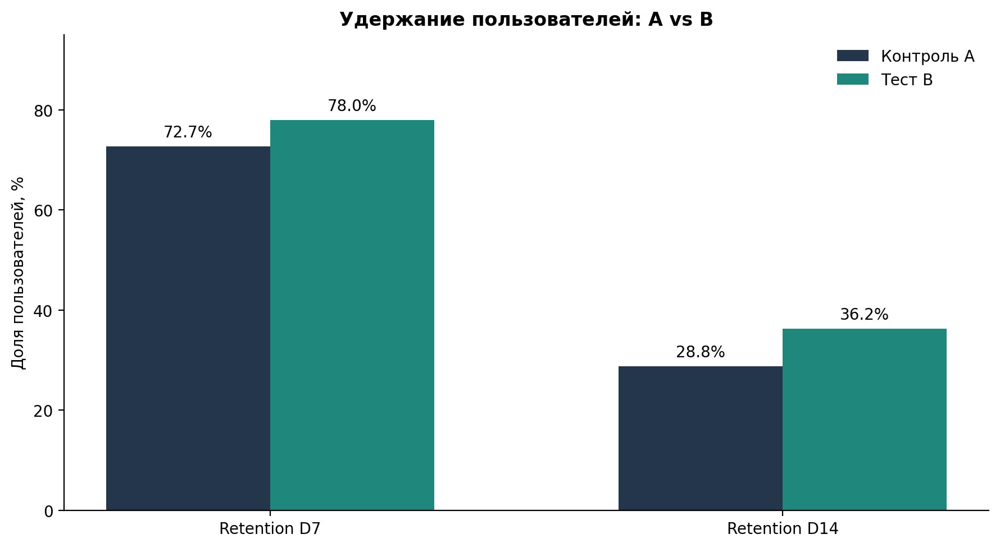
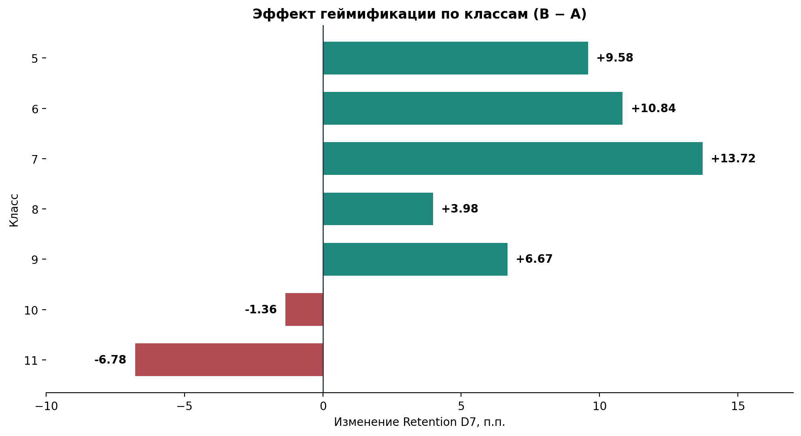

# A/B-тест геймификации образовательной платформы

**Product Analytics · A/B Testing · Python · Statistical Inference · EdTech**

> **Ключевой результат:** внедрение геймификации увеличило Retention D7 на **5,26 п.п.**, Retention D14 — на **7,46 п.п.**, а конверсию в завершение хотя бы одного домашнего задания — на **1,20 п.п.**
>
> Однако сегментный анализ выявил неоднородность эффекта: в 10–11 классах наблюдаются отрицательные различия удержания. **Продуктовое решение — доработать механику перед массовым внедрением.**

**[Бизнес-презентация (PDF)](reports/VK_Education_AB_Test.pdf)** · **[EDA](notebooks/1_EDA.ipynb)** · **[Продуктовые метрики](notebooks/2_Metrics.ipynb)** · **[Статистический анализ](notebooks/3_AB_Test.ipynb)**

---

## 1. Бизнес-контекст

Образовательная платформа рассматривает внедрение системы достижений за решение задач. Предполагается, что дополнительная игровая мотивация поможет ученикам чаще возвращаться к обучению и активнее выполнять домашние задания.

**Цель исследования:** оценить влияние новой механики на продуктовые метрики и определить, целесообразно ли внедрять её для всей аудитории.

| Параметр | Описание |
|---|---|
| Группа A | Контроль: интерфейс без геймификации |
| Группа B | Тест: интерфейс с системой достижений |
| Продолжительность | 3 недели |
| Выборка после очистки | 5 992 пользователя |
| Размер групп | A — 2 997; B — 2 995 |
| Аудитория | Ученики 5–11 классов |

## 2. Результаты эксперимента

| Метрика | Контроль A | Тест B | Эффект B − A | 95% ДИ |
|---|---:|---:|---:|---|
| Retention D7 | 72,71% | 77,96% | **+5,26 п.п.** | [+3,08; +7,43] |
| Retention D14 | 28,76% | 36,23% | **+7,46 п.п.** | [+5,10; +9,82] |
| Homework Conversion | 97,63% | 98,83% | **+1,20 п.п.** | [+0,54; +1,89] |

*Homework Conversion — доля пользователей, завершивших хотя бы одно домашнее задание за период наблюдения.*

### Влияние геймификации на удержание



На общей выборке тестовая группа демонстрирует более высокое удержание как на 7-й, так и на 14-й день.

**Статистическая значимость:**

| Метрика | p-value после поправки Холма |
|---|---:|
| Retention D7 | 0,00000471 |
| Retention D14 | 2,06 × 10⁻⁹ |
| Homework Conversion | 0,000424 |

Все три различия статистически значимы при α = 0,05. Доверительные интервалы эффектов не включают ноль.

## 3. Ключевой инсайт: эффект зависит от класса

Общий положительный результат не означает одинакового влияния геймификации на все пользовательские сегменты.

### Эффект на Retention D7 по классам



| Класс | Эффект B − A |
|---|---:|
| 5 | +9,58 п.п. |
| 6 | +10,84 п.п. |
| 7 | +13,72 п.п. |
| 8 | +3,98 п.п. |
| 9 | +6,67 п.п. |
| 10 | −1,36 п.п. |
| 11 | −6,78 п.п. |

**Что обнаружено:**

- Наиболее выраженные положительные различия — в 5–7 классах.
- В 10–11 классах наблюдаются отрицательные оценки эффекта.
- Логистическая регрессия с взаимодействием `группа × класс` подтвердила неоднородность эффекта для D7 и D14 (p < 0,001).

Отрицательные значения в старших классах не доказывают статистически значимый вред в каждом отдельном сегменте. Для этого необходимы дополнительные проверки.

**Продуктовая интерпретация:** одна и та же игровая механика может по-разному влиять на учеников разных классов. Поэтому решение о массовом внедрении нельзя принимать исключительно по среднему эффекту.

## 4. Методология

### Подготовка данных и проверка эксперимента

Проведены:

- Проверка пропусков, дубликатов и распределения пользователей.
- Исключение 8 пользователей, попавших одновременно в группы A и B.
- Удаление 2 точных дубликатов событий.
- Проверка Sample Ratio Mismatch (SRM): p = 0,979 при ожидаемом распределении 50/50.

Статистически значимого нарушения соотношения групп не обнаружено.

### Продуктовые метрики

Рассчитаны:

- **Retention D7 / D14** — доля пользователей с соответствующими событиями возвращения.
- **Homework Conversion** — доля уникальных пользователей, завершивших хотя бы одно домашнее задание.
- **Event Funnel** — наличие событий `login → homework_started → homework_completed`.

Единица анализа — уникальный пользователь.

### Статистический анализ

| Метод | Для чего использовался |
|---|---|
| Двусторонний z-тест долей | Сравнение бинарных метрик A и B |
| 95% ДИ Newcombe | Оценка неопределённости разницы долей |
| Holm correction | Поправка на три статистические проверки |
| MDE | Оценка минимального обнаруживаемого эффекта |
| Логистическая регрессия | Проверка взаимодействия группы и класса |
| Sensitivity Analysis | Проверка устойчивости результатов к экстремальной активности |

При проверке устойчивости исключены 12 пользователей с более чем 500 событиями. Основные результаты практически не изменились.

## 5. Бизнес-решение

### Рекомендация: доработать перед массовым запуском

Несмотря на статистически значимый положительный эффект на общей выборке, неоднородность результатов требует дополнительного исследования.

**Следующие шаги для продуктовой команды:**

1. Изучить пользовательские сценарии и возможные причины менее благоприятных результатов в 10–11 классах.
2. Адаптировать систему достижений под разные группы учеников.
3. Провести подтверждающий A/B-тест с заранее определённой основной метрикой и критериями принятия решения.
4. Добавить события завершения курсов и модулей для более точного измерения образовательного результата.

**Итог:** геймификация перспективна, но текущих результатов недостаточно для безусловного массового запуска.

## 6. Ограничения исследования

- **Course Completion Rate:** в логах отсутствует событие завершения курса или модуля. Вместо него анализируется завершение хотя бы одного домашнего задания.
- **Воронка:** построена по наличию событий у пользователей, а не по строгой последовательности действий.
- **Retention:** использованы события `return_visit_d7` и `return_visit_d14`; их точная интерпретация зависит от определения событий в источнике данных.
- **Сегментный анализ:** неоднородность эффекта подтверждена, но индивидуальная статистическая значимость отрицательных эффектов в каждом классе отдельно не установлена.

## 7. Технологии

**Python:** pandas, NumPy, SciPy, statsmodels, Matplotlib, seaborn.

**Среда:** Jupyter Notebook, VS Code.

**Методы:** EDA, A/B testing, проверка SRM, доверительные интервалы, множественные проверки гипотез, MDE, логистическая регрессия, анализ чувствительности.

Все графики для README создаются с помощью Matplotlib непосредственно из рассчитанных метрик в ноутбуках и сохраняются через `plt.savefig()`.

## 8. Структура проекта

```text
.
├── data/
│   ├── ab_test_users_groups.csv
│   ├── ab_test_events.csv
│   └── ab_events_clean.csv
├── notebooks/
│   ├── 1_EDA.ipynb
│   ├── 2_Metrics.ipynb
│   └── 3_AB_Test.ipynb
├── images/
│   ├── retention_comparison.png
│   └── retention_by_grade.png
├── reports/
│   └── VK_Education_AB_Test.pdf
├── .gitignore
├── requirements.txt
└── README.md
```

## 9. Воспроизведение анализа

**1. Клонировать репозиторий:**

```bash
git clone https://github.com/SonteikaMaki/vk-education-edtech-gamification-ab-test.git
cd vk-education-edtech-gamification-ab-test
```

**2. Установить зависимости:**

```bash
python -m pip install -r requirements.txt
```

**3. Открыть ноутбуки в VS Code или Jupyter и выполнить по порядку:**

1. `1_EDA.ipynb` — очистка данных, SRM и сохранение `ab_events_clean.csv`.
2. `2_Metrics.ipynb` — расчёт продуктовых метрик и экспорт `retention_comparison.png`.
3. `3_AB_Test.ipynb` — статистические тесты, сегментация, экспорт `retention_by_grade.png` и бизнес-вывод.

При запуске следует проверить текущую рабочую директорию Jupyter и корректность относительных путей к файлам.

## 10. Материалы проекта

**[Бизнес-презентация — 5 слайдов (PDF)](reports/VK_Education_AB_Test.pdf)**

Презентация содержит ключевые результаты, статистическую интерпретацию, сегментный анализ и рекомендации для продуктовой команды.

---

*Учебный проект по заданию VK Education. Анализ выполнен в формате продуктового A/B-кейса.*